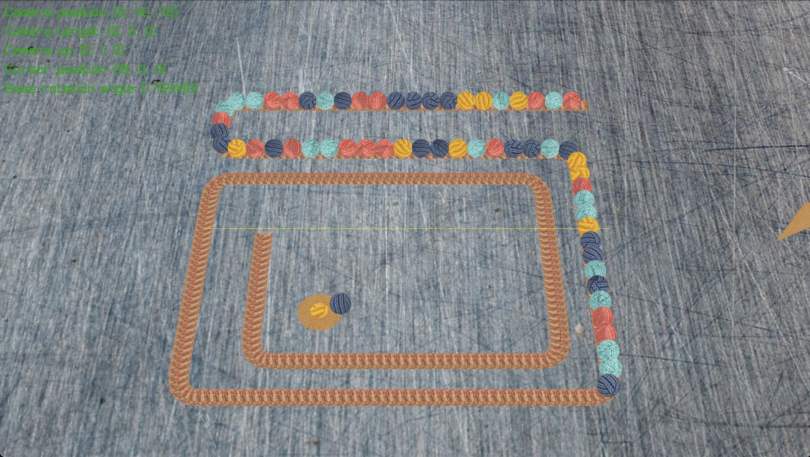

# Simbanadu

A colorful arcade puzzle game built with [raylib](https://www.raylib.com/)



## About

**Simbanadu** is a personal game project inspired by classic arcade puzzle games. The goal is to create an engaging, fast-paced experience centered around matching colored marbles, clearing chains, and keeping the action going.

Built in C with raylib.

## Requirements

Before building the game, make sure you have the following installed:

- **macOS**
- **CMake** (3.16 or newer)
- **A C compiler** supporting C99
- **raylib**, installed via [Homebrew](https://brew.sh/)

Install the dependencies with Homebrew:

```bash
brew install cmake raylib
```

> **Note:** The current `CMakeLists.txt` expects raylib to be installed at `/opt/homebrew/opt/raylib`, the default Homebrew prefix on Apple Silicon Macs. Intel Macs may use a different installation path and require adjustments to the CMake configuration.

## Getting Started

Clone the repository and navigate to the project directory:

```bash
git clone <repository-url>
cd Simbanadu
```

### Build and Run

To build and launch the game, run:

```bash
./build_and_run.sh
```

This script builds the project with debug mode enabled and launches the game.

When debug mode is active, additional debugging information, such as logs and other details, is displayed in the upper-left corner of the game window.

### Build Only

To compile the game without launching it, run:

```bash
./build.sh
```

This script:

1. Removes any existing `build/` directory.
2. Creates a fresh build directory.
3. Configures the project with CMake.
4. Compiles the source code.

The resulting executable is located at:

```text
build/App
```

### Debug Mode

Debug mode is enabled by default when using `build.sh` or `build_and_run.sh`, through the `-DDEBUG=ON` CMake option.

To build without debug mode, run:

```bash
mkdir -p build
cd build
cmake -DDEBUG=OFF ..
make
```

Then launch the game:

```bash
./build/App
```

The `DEBUG` preprocessor definition allows the source code to enable additional logging and debugging information when needed.

### Note about `resources/audio/sounds/cat`

The `wav` files in `resources/audio/sounds/cat` are blank `wav` files. Replace these with whatever audio samples you like, as long as the file names match.

## Project Structure

```text
├── CMakeLists.txt          # CMake build configuration
├── README.md
├── build.sh                # Build the game
├── build_and_run.sh        # Build and launch the game
├── resources               # Blender models and audio samples used in the game
├── screenshots
├── scripts                 # Useful scripts (like exporting data from Blender)
├── src                     # Game source code and headers
```

## Built With

- [C](<https://en.wikipedia.org/wiki/C_(programming_language)>) — C99
- [raylib](https://www.raylib.com/) — Game programming library
- [CMake](https://cmake.org/) — Build configuration
- [Homebrew](https://brew.sh/) — Dependency management on macOS
